# AI assistant AutoWise: cấu trúc và cách thực hiện toàn bộ flow

Đối chiếu mã nguồn ngày 11/10/2026. Đây là tài liệu giải thích implementation hiện tại, bổ sung cho [sơ đồ tổng thể](ai-assistant-full-flow.md). Ví dụ JSON, dữ liệu mẫu và phép tính dưới đây dùng để giải thích thuật toán, không phải log chạy thật hoặc giá xe thực tế. Các sơ đồ được chèn bằng SVG để xem được trong Markdown Preview.

## 1. Một câu hỏi đi qua những gì?

Ví dụ: **“Tư vấn SUV 5 chỗ, ngân sách tối đa 1 tỷ.”**

Hệ thống thực hiện theo thứ tự:

1. React nhận text/ảnh và context hội thoại, gửi input thô tới endpoint phù hợp với session đăng nhập.
2. Backend kiểm input và quyền; với customer kiểm session owner, requestId và version.
3. Bedrock diễn giải câu hỏi, sửa cách viết nếu ý định rõ và chọn route catalogue/orders/clarification.
4. Catalogue analyzer xác định intent, tên xe/carIds và filters. Bước này chủ yếu dùng luật trong Python, có classifier Bedrock bổ sung.
5. SQL lọc tập xe đúng điều kiện. Ví dụ SUV, 5 chỗ, giá có nguồn và không vượt 1.000.000.000 VND.
6. Tạo tập documents/facts hợp lệ; lexical và vector search tìm đoạn liên quan trong phạm vi này.
7. Hợp nhất thứ hạng, chọn evidence, dựng context và draft được kiểm tra.
8. Bedrock viết câu trả lời tự nhiên từ dữ liệu đã truy xuất.
9. Backend kiểm trực tiếp và Bedrock review câu trả lời cuối; nếu sai cho sửa một lần, vẫn sai trả lỗi.
10. UI hiển thị câu trả lời, nguồn, kết quả có cấu trúc và gợi ý bước tiếp theo. Customer lưu lịch sử trên server.


Điểm cần phân biệt: **SQL lọc đúng điều kiện nghiệp vụ, vector tìm nội dung gần nghĩa, model diễn giải và trình bày.** Hệ thống không đưa câu hỏi cho LLM rồi chạy SQL bất kỳ do LLM sinh ra.

## 2. Cấu trúc các lớp

| Lớp | Nhiệm vụ | Mã nguồn chính |
|---|---|---|
| Frontend React | Nhập câu hỏi/ảnh, chọn endpoint theo đăng nhập, render sources/cards/gợi ý, giữ input khi lỗi | [ChatPage](../frontend/src/pages/ChatPage/index.tsx), [OrderAssistantPage](../frontend/src/features/orders/OrderAssistantPage.tsx) |
| Python HTTP | Guest turns, common chat, các API nội bộ understand/compose/title | [guest_chat.py](../backend/app/routers/guest_chat.py), [chat.py](../backend/app/routers/chat.py) |
| Python application | Analyze intent, retrieve, context, draft và so sánh | [rag/](../backend/app/application/rag/), [compare.py](../backend/app/application/compare.py) |
| Python repository | SQL có tham số, snapshot, lexical và pgvector | [rag_repository.py](../backend/app/repositories/rag_repository.py) |
| AI infrastructure | Bedrock Converse, E5 embeddings, viết và review | [ai/](../backend/app/infrastructure/ai/) |
| C# orchestration | Owner/history/version, route catalogue hoặc orders, context đơn, business tools | [UnifiedAssistant.cs](../services/owner-features/src/AutoWise.OwnerFeatures.Infrastructure/UnifiedAssistant.cs), [OrderAssistant.cs](../services/owner-features/src/AutoWise.OwnerFeatures.Infrastructure/OrderAssistant.cs) |
| Image service | Extractor ảnh, FAISS, confidence, adapter tới common RAG | [image_service/app/core/](../image_service/app/core/) |
| PostgreSQL | Catalogue, documents/vectors và schema nghiệp vụ orders_service | [database/](../database/) |

Bedrock được cấu hình mặc định với Claude Haiku 4.5; text embedding là `intfloat/multilingual-e5-base`, 768 chiều. Provider/config có thể đổi bằng cấu hình, không nên hiểu tên model là điều kiện cố định của toàn bộ kiến trúc.

## 3. Nhận câu hỏi và context

### 3.1 Guest

Frontend gọi `POST /api/chat/turns` với:

```json
{
  "question": "Tư vấn SUV 5 chỗ, ngân sách tối đa 1 tỷ",
  "recentQuestions": [],
  "lastAnswer": "",
  "lastContexts": []
}
```

Nếu có ảnh, thêm `imageBase64` và `mimeType`. Chấp nhận JPEG/PNG/WebP, tối đa 10 MB. Guest chỉ gửi tối đa 3 câu hỏi gần nhất, câu trả lời gần nhất tối đa 1.800 ký tự và ID/tên xe trong `lastContexts`. Backend không xem mô tả từ browser là evidence đáng tin.

Guest history ở `sessionStorage`, chưa có session RAG guest lưu DB. Nếu hỏi đơn, backend trả `requiresLogin=true`; frontend giữ câu hỏi và có thể giữ lượt ảnh đang chờ để tiếp tục sau đăng nhập.

### 3.2 Customer

Frontend gọi `POST /api/orders-service/assistant/sessions/{id}/turns` với các trường như:

```json
{
  "requestId": "UUID-do-client-tao",
  "version": 3,
  "content": "Đơn AW-DEMO còn phải trả bao nhiêu?",
  "orderId": null
}
```

`requestId` minh họa trên phải là UUID hợp lệ trong request thật. C# kiểm owner session, hash input, requestId và version, rồi đọc history server. Trùng requestId và cùng hash trả lại session đã lưu; cùng ID nhưng khác input hoặc version cũ gây conflict. Khi ghi server khóa theo session và kiểm lại, tránh hai lượt đồng thời ghi đè nhau.

Chặn câu hỏi thống kê quản trị trước model ở cả guest/customer. Refusal này dùng policy, không đi qua RAG/Bedrock. Các trường thiếu/sai và ảnh quá lớn cũng được xử lý trước các bước tốn chi phí.

## 4. Hiểu câu hỏi: diễn giải khác với truy xuất

Hàm [understand()](../backend/app/infrastructure/ai/question_understanding.py) gọi Bedrock với câu hỏi và context. Prompt yêu cầu trả JSON đúng schema:

```json
{
  "question": "Bảo hành xe này như thế nào?",
  "route": "catalogue",
  "needsClarification": false,
  "clarification": null
}
```

Ví dụ input `bao hnah xe nay ntn` có thể được sửa thành câu trên. Model chỉ diễn giải ý định, không trả lời dữ kiện ở bước này.

| Route | Khi sử dụng | Xử lý tiếp |
|---|---|---|
| `catalogue` | Tìm/tư vấn/so sánh/thông tin xe, ảnh xe | Text RAG hoặc image service |
| `orders` | Đơn thuộc tài khoản, cọc/thanh toán, nhận xe, hồ sơ và yêu cầu tài khoản | Guest yêu cầu login; customer dùng công cụ C# |
| `clarification` | Có nhiều cách hiểu, thiếu thông tin để hiểu ý định | Trả câu hỏi làm rõ qua compose |

Prompt giữ mọi chủ đề của câu đa ý định. Ảnh không được ghi đè ý định đơn: “Ảnh này có khớp xe trên đơn AW-… không?” phải đi route orders. Thiếu mã đơn nhưng đã rõ chủ đề không cần route clarification; OrderAssistant chọn đơn hoặc hỏi mã sau.

Sau output, Python so tập mã `AW-…` và số trong input/output. Nếu model thay mã hoặc thêm số mới, câu diễn giải bị thay lại bằng input gốc. Đây là kiểm tra tập mã/số cụ thể, không phải chứng minh model giữ nguyên toàn bộ ý nghĩa. Pydantic kiểm schema. Lỗi Bedrock/JSON ở bước hiểu trả 503.

Với câu “xe đó”, nhánh catalogue dùng car context gần nhất để thêm tên xe và giới hạn carIds; với câu xác nhận ngắn, có logic dùng lại câu hỏi trước. Context giúp xác định đối tượng, còn facts vẫn phải truy xuất lại.

## 5. Từ câu hỏi đã hiểu sang intent, entities và filters

Hàm [analyze()](../backend/app/application/rag/intent.py) nhận câu hỏi và catalogue. Nó chuẩn hóa về chữ thường, bỏ dấu và gom khoảng trắng rồi áp dụng luật.

### 5.1 Trích điều kiện

| Nội dung câu hỏi | Cách phân tích |
|---|---|
| Hãng | Khớp tên hãng từ catalogue; một hãng rõ thì đưa vào filter |
| “SUV”, “gầm cao”, “bán tải” | Map synonym tới `body_type` |
| “xăng”, “máy dầu”, “xe điện”, “hybrid” | Map tới `fuel_type` |
| “số sàn”, “số tự động”, “CVT” | Map tới `transmission` |
| “5 chỗ”, “7 ghế” | Regex lấy `seats`; nhiều giá trị khác nhau phải làm rõ |
| “Hà Nội”, “Sài Gòn” | Map city phục vụ tìm đại lý |
| “không quá/tối đa” | `max_price` và inclusive=true |
| “dưới/ít hơn” | `max_price` và inclusive=false |
| “ít nhất/tối thiểu” | `min_price` và inclusive=true |
| “trên/hơn” | `min_price` và inclusive=false |
| “từ 700 triệu đến 1 tỷ” | Khoảng min/max, chuyển về VND bằng Decimal |

Số chỗ, HP, km, mm, năm/tháng không bị coi là tiền. “Ngân sách 1 tỷ” là trần giá, không phải yêu cầu giá đúng bằng 1 tỷ. Khoảng min lớn hơn max bị từ chối/làm rõ. Filters tường minh từ request được merge và ưu tiên cho các trường đã cung cấp; backend vẫn kiểm phạm vi và dữ liệu.

Ví dụ output phân tích, rút gọn theo ý nghĩa các trường:

```json
{
  "intent": "find_car",
  "car_ids": [],
  "filters": {
    "body_type": "SUV",
    "seats": 5,
    "max_price": 1000000000,
    "max_price_inclusive": true
  },
  "ambiguities": []
}
```

### 5.2 Nhận tên xe

Analyzer so tên đầy đủ, tên bỏ năm, tên model ngắn và aliases. Nó hỗ trợ biến thể dấu cách/dấu gạch và fuzzy match nhỏ bằng `SequenceMatcher`: model compact đủ dài, lệch độ dài tối đa 1 ký tự, cùng ký tự đầu và similarity >= 0,8. Tên ngắn yêu cầu compact exact match. Chọn match dài trước để tránh một tên ngắn ăn vào tên đầy đủ. Cùng đoạn khớp nhiều mẫu thì yêu cầu làm rõ.

`carIds` tường minh phải tồn tại trong catalogue. Ảnh và reference hội thoại có thể đưa carIds để giới hạn đúng mẫu. Hỏi thuộc tính một xe đã nêu tên không nên dùng điều kiện thuộc tính để lọc mất chính xe đó; code xóa các filters loại xe/số chỗ/nhiên liệu/hộp số/giá ở trường hợp tương ứng.

### 5.3 Chọn intent

Luật ưu tiên các nhóm: `compare_cars`, `find_dealer`, `ask_warranty`, `find_car`, `ask_price`, `ask_specification`; trường hợp chưa rõ mới có thể dùng Bedrock classifier. Với câu nhắc năm/phiên bản, ghi limitation vì dữ liệu chủ yếu ở cấp model. Đây là parser kết hợp luật và model, chưa phải bộ semantic parser hiểu mọi cấu trúc tiếng Việt.

## 6. Câu hỏi chuyển thành SQL như thế nào?

[RagRepository.candidates()](../backend/app/repositories/rag_repository.py) nhận filters/carIds. Backend tự tạo các clause từ danh sách trường cho phép, còn giá trị truyền qua `$1`, `$2`… bằng asyncpg.

Ví dụ tương đương logic cho SUV 5 chỗ dưới hoặc bằng 1 tỷ:

```sql
SELECT *
FROM cars
WHERE lower(body_type) = lower($1::text)
  AND seats = $2
  AND price_vnd_from <= $3
  AND price_source_id IS NOT NULL
ORDER BY price_vnd_from NULLS LAST, display_name
LIMIT 100;
```

Tham số là `['SUV', 5, 1000000000]`. Câu hỏi “dưới 1 tỷ” tạo `<`, không tạo `<=`. Mẫu SQL trên minh họa các clause; code xây câu SQL theo thứ tự trường có mặt trong filters.

Giá không có nguồn bị loại khỏi bài toán ngân sách. Khi có carIds, thêm `car_id = ANY($n::text[])`. Sau query, Python còn `matches_filters()` để kiểm lại. Sau đó lấy snapshot catalogue/bảo hành/đại lý/sources bằng transaction `repeatable_read`, chỉ đọc và ngắn; không chạy model trong transaction này.

**SQL ở đây chọn đối tượng hợp lệ; nó chưa quyết định đoạn nào cần đưa vào câu trả lời.** Việc chọn đoạn liên quan do retrieval ở bước tiếp theo. Tập catalogue/snapshot hiện có giới hạn 100 xe, cần thay cách lấy dữ liệu nếu dataset tăng vượt phạm vi này.

## 7. Documents, lexical và vector được tạo/tìm như thế nào?



### 7.1 Index được tạo trước lúc chat

`scripts/build_text_index.py` đọc dữ liệu có cấu trúc, tạo documents tiếng Việt theo sections `overview`, `specifications`, `price`, `warranty`, `dealer`. Documents chứa nội dung, facts, sourceIds, subject/carId và content hash. Chunks giữ nguyên claim và chủ thể, không cắt tùy ý giữa số và thuộc tính.

E5 encode document bằng prefix `passage: `, normalize L2, kiểm 768 chiều hữu hạn và norm khác 0. PostgreSQL lưu vector cùng model/version. Job chỉ cập nhật documents thay đổi, xóa orphan, embed dữ liệu thiếu/khác revision; kiểm content hash trước khi ghi để tránh ghi vector cho bản document đã thay đổi.

### 7.2 Khi chat, chọn sections phù hợp

| Intent | Sections ưu tiên/cho phép |
|---|---|
| `ask_price` | `price` |
| `ask_specification` | `specifications`, `overview` |
| `ask_warranty` | `warranty` |
| `find_dealer` | `dealer`, kèm lọc hãng/city |
| `find_car`, `compare_cars` và nhóm mặc định | `overview`, `specifications`, `price`, `warranty` |

Retriever dựng documents hiện tại từ snapshot. ID của chúng tạo phạm vi search; lexical/vector không tìm tùy ý toàn bộ dữ liệu ngoài điều kiện SQL.

### 7.3 Lexical search

PostgreSQL dùng `websearch_to_tsquery('simple', query)`, so với `search_vector`, xếp hạng bằng `ts_rank_cd`, lấy tối đa 30 chunks. Đây là khớp từ khóa qua full-text search, không phải model embedding. Tên xe/từ khóa cụ thể thường hữu ích; từ khác cách diễn đạt có thể không khớp.

### 7.4 Vector search

E5 encode `query: <câu hỏi>` thành vector 768 chiều, chuẩn hóa L2. Repository dùng cosine distance của pgvector:

```sql
SELECT d.*, 1 - (text_embedding <=> $1::vector) AS score
FROM documents d
WHERE split_part(document_id, ':part:', 1) = ANY($2::text[])
  AND text_embedding IS NOT NULL
  AND embedding_model = $3
  AND embedding_version = $4
ORDER BY text_embedding <=> $1::vector, document_id
LIMIT 30;
```

`$1`: vector query; `$2`: IDs của documents được phép; `$3/$4`: model/version. Khoảng cách nhỏ hơn là gần hơn; `score = 1 - distance` để hiển thị/xếp dữ liệu. Query cần model/version phù hợp index; code kiểm khả năng dùng index và SQL lọc đúng revision. Index ảnh FAISS không tham gia query pgvector này.

### 7.5 Hợp nhất kết quả

Code hiện gọi lexical rồi vector, sau đó dùng **Reciprocal Rank Fusion (RRF)**; không cộng trực tiếp `ts_rank_cd` với cosine similarity vì hai thang điểm khác nhau.

```text
RRF(document) = tổng 1 / (60 + rank)
```

Ví dụ document A đứng lexical #1 và vector #2 có điểm `1/61 + 1/62 ≈ 0,03252`. Document B chỉ đứng vector #1 có điểm `1/61 ≈ 0,01639`. Đây là ví dụ thứ hạng, không phải confidence câu trả lời.

Thực tế code lọc chunks không khớp content hash với documents hiện tại **trước khi RRF**. Sau RRF bổ sung documents SQL chưa xuất hiện, theo ưu tiên section. `topK` giới hạn 1–20. Retriever dành slot cho từng carId rồi mới lấp phần budget còn lại. So sánh có ưu tiên section riêng.

Nếu lexical/vector thiếu/lỗi, vẫn có thể dùng facts structured từ SQL. Chế độ retrieval có thể là hybrid, vector, lexical hoặc structured. Không có một bước cross-encoder reranker riêng trong flow đã đối chiếu. Có thêm bước kiểm chứng câu trả lời cuối; retrieval thành công không đồng nghĩa response cuối chắc chắn thành công.

## 8. Từ evidence sang context và draft

[build_context()](../backend/app/application/rag/context_builder.py) tạo ba lớp reference:

| Trường | Dùng để làm gì? |
|---|---|
| `contextId` | Định danh evidence/document hoặc chunk |
| `factId` | Fact cụ thể trong context, như giá hoặc số chỗ |
| `subjectId` | Fact thuộc xe/đối tượng nào |

Ví dụ cấu trúc rút gọn với IDs minh họa:

```json
{
  "facts": {
    "ctx-a:seats": {
      "value": 5,
      "unit": null,
      "contextId": "ctx-a",
      "subjectId": "car-demo"
    }
  },
  "allowedStatements": [
    {"text": "Xe minh họa có 5 chỗ.", "factIds": ["ctx-a:seats"]}
  ]
}
```

Draft RAG là bước chọn statements đã kiểm chứng, không tự diễn giải facts mới. `validate_draft()` yêu cầu exact allowed statements, fact/context references tồn tại, fact thuộc đúng context và reference khớp statements thực sự dùng. Model không được thêm URL. Có tối đa hai lần generate draft; không hợp lệ/lỗi có thể dùng template facts nội bộ.

Backend thêm qualifiers về giá tham khảo, thị trường, thông số UK, bảo hành và dữ liệu thiếu. Template draft là dữ liệu trung gian; endpoint chat vẫn gọi bước viết tự nhiên và review cuối.

## 9. So sánh xe: nhận câu hỏi và lấy kết quả ra sao?


Ví dụ: **“So sánh giá và số chỗ Honda CR-V với Mazda CX-5.”**

1. Understanding giữ hai mẫu xe và cả hai tiêu chí.
2. Analyzer nhận từ “so sánh”, đặt `compare_cars`, resolve hai carIds từ catalogue.
3. Yêu cầu 2–3 mẫu xe. Nếu chỉ resolve một mẫu, tên mơ hồ hoặc hơn 3 mẫu, hỏi lại.
4. Xóa brand filter trong so sánh: hãng của một xe là chủ thể, không phải điều kiện loại hãng của xe còn lại.
5. SQL lấy đúng các carIds; nếu một xe thiếu/không đáp ứng filters thì làm rõ. Không âm thầm chỉ so xe còn lại.
6. Retriever kiểm `topK` đủ cho các xe được yêu cầu, dành evidence cho từng xe và ưu tiên price/specifications.
7. `requested_spec_fields()` và `comparison_requirements()` xác định các cặp `(carId, field)` cần phủ khi field có dữ liệu; draft phải nhắc các xe và phủ facts được yêu cầu có sẵn. Facts thiếu được ghi thành limitation/partial, không tự điền.
8. Python chuẩn bị `referencePriceDifferences` bằng `abs(priceA - priceB)` khi cả hai có giá và nguồn. Model được dùng phép chênh lệch đã tính, không tự tính số mới.
9. Compose viết bảng Markdown; backend kiểm giá theo tên xe/cột bảng để phát hiện đảo giá, rồi semantic review cả chủ thể, thuộc tính và qualifier.
10. Response có contexts, evidence và citations; UI render bảng và liên kết xe.

Coverage của so sánh là budget evidence hữu hạn. Dù dành một slot cho mỗi xe, không đảm bảo mọi section đều lọt topK; code phát hiện thiếu coverage và có thể trả `partial`. Luật requirements hiện nhắm các trường specification được parser nhận và giá; không nên coi đây là kiểm chứng bao phủ mọi tiêu chí tự do người dùng có thể hỏi.

### So sánh chat khác trang /compare

Trang `/compare` dùng API `GET /api/cars/compare?ids=...`, kiểm 2–3 IDs khác nhau, lấy CarDto và trả `missingIds` khi cần. React `ComparisonTable` hiển thị fields cố định, đánh dấu khác biệt và chế độ chỉ xem khác nhau bằng so giá trị trực tiếp. Thiếu field thì “Chưa có dữ liệu”. **Luồng trang compare không cần Bedrock, E5 hoặc RAG**; chat so sánh có diễn giải, retrieval và review. Hai cách dùng cùng catalogue nhưng khác đường xử lý.

## 10. Viết câu trả lời cuối và kiểm chứng

[compose_grounded()](../backend/app/infrastructure/ai/natural_answers.py) nhận `verifiedData`: retrievedAnswer, cars/sections, evidence, citations, searchConstraints, qualifiers và imageMatch nếu có.

Lần gọi Bedrock đầu viết tiếng Việt tự nhiên. Prompt yêu cầu chỉ dùng dữ liệu được cung cấp, giữ đúng subject/attribute/số/đơn vị, không đổi giá thành triệu/tỷ, không tự tính tỷ lệ hoặc khẳng định hành động đã chạy. Khi so sánh dùng bảng với mỗi xe một cột.

Sau đó có hai nhóm kiểm tra:

| Nhóm | Kiểm tra |
|---|---|
| Backend deterministic | Số không có trong dữ liệu, đơn vị bị đổi, URL/HTML, đảo giá giữa xe trong prose/bảng, cảnh báo similarity/uncertain và phạm vi thông số |
| Bedrock semantic review | Mỗi claim có đúng chủ thể/thuộc tính/trạng thái/phủ định/điều kiện nguồn; thiếu dữ liệu và qualifier có được giữ; draft có bị nói như hành động đã thực hiện |

Review trả `supported`, `contextIds`, `reason`. Backend từ chối IDs lạ/trùng, claim factual có evidence mà không chọn reference hỗ trợ. Citations được lọc từ registry backend theo contextIds của **câu trả lời cuối**, model không sinh URL/sourceId mới.

Nếu validation/review không hợp lệ, gửi feedback cho lần viết lại; tối đa một lần repair. Vẫn sai hoặc provider lỗi trả 503. Throttling Bedrock có retry riêng, tối đa hai lần retry trong timeout của invocation; không nhầm với repair nội dung.

Response điển hình có các trường:

```json
{
  "answer": "Nội dung đã viết và review",
  "generationMode": "bedrock-natural",
  "grounded": true,
  "status": "ok",
  "contexts": [],
  "evidence": [],
  "citations": []
}
```

Ví dụ trên chỉ liệt kê hình dạng, không phải response hợp lệ cho câu factual: thực tế `grounded=true` yêu cầu selected evidence và status ok/partial. `needs_clarification`/`no_data` có thể không có references và `grounded=false` dù bước compose/review đã chạy. Grounded là kết quả kiểm chứng theo evidence, không phải bảo đảm chân lý tuyệt đối.

## 11. Câu hỏi về đơn: SQL công cụ thay cho vector

Khi route orders, customer được chuyển đến [OrderAssistant](../services/owner-features/src/AutoWise.OwnerFeatures.Infrastructure/OrderAssistant.cs). Nhánh này lấy dữ liệu nghiệp vụ bằng EF/SQL có owner, không dùng vector để tìm đơn.

Context lưu current/previous order, topics gần nhất, pending clarification/intents, summary và drafts. Backend kiểm lại owner các references, kết hợp luật cục bộ với Bedrock resolve context; summary chỉ chạy khi bật cấu hình. Topics nêu rõ trong câu hỏi ưu tiên hơn topics lịch sử. Mã mới không bị thay bằng đơn cũ.

| Câu hỏi | Công cụ/dữ liệu |
|---|---|
| “Đơn nào của tôi?” | `ListMyOrders`, tối đa 20 đơn gần nhất |
| “Đang tới bước nào, cần làm gì?” | `GetMyOrderProgress`, status/timeline/nextActions |
| “Còn phải trả bao nhiêu, cọc đã ghi nhận chưa?” | `GetMyOrderPaymentSummary`, OrderEvidence và giao dịch đã xác nhận |
| “Khi nào nhận xe?” | `GetMyDeliverySchedule`, phân biệt planned/confirmed/handed_over/cancelled |
| “Thiếu giấy tờ gì?” | `GetMyOrderDocuments`, checklist hồ sơ |
| “Xe/bảo hành trên đơn?” | `GetCarDetail` / `GetWarranty` qua Python catalogue API |
| Câu nhiều chủ đề | `GetMyOrderTopics`, tập sections |

Ví dụ “Đơn AW-DEMO đang đến đâu, còn nợ bao nhiêu, khi nào nhận xe?” tách status/payment/delivery. Mỗi section có topic, resultStatus, retrievedAt và detailUrl. Đơn không thuộc user không được lấy dù model đề xuất đúng ID. Nhiều mã hoặc code khác orderId đang chọn phải làm rõ. Không có reference thì hỏi mã đơn, nhớ pending topics để tiếp tục.

Các sections được đưa tới Python `/api/chat/compose`. `canonical_sources()` gán tool contextIds và nguồn; final metadata được lưu cùng messages. Topic catalogue lỗi/thiếu phải giữ section error/missing; các topic khác vẫn có thể trả thành partial.

## 12. Nếu câu hỏi có ảnh

Ảnh catalogue qua image service `/chat`: decode → extractor tương thích index → FAISS search → gom theo carId → tính confidence theo top-1 similarity và margin top-2 → chỉ dùng top 1. Adapter gửi câu hỏi, carIds và imageMatch tới common `/api/chat`; RAG lấy facts đúng mẫu rồi compose/review như text.

Ảnh + đơn qua UnifiedAssistant: gọi image `/search/image`, lấy top 1 sau confidence → OrderAssistant lấy đơn theo owner → so `image.carId == order.carId` → tạo section image → compose/review. Guest hỏi ảnh của đơn phải login trước khi truy cập đơn.

Độ tương đồng không phải xác suất. Chỉ kết luận mẫu gần giống/khớp catalogue trên đơn, không xác minh chiếc xe/VIN. Cần weights/preprocessing/index tương thích; FAISS ảnh là index riêng, không nằm trong text pgvector. Không có kết quả/lỗi ảnh có thể dẫn tới yêu cầu làm rõ; lỗi AI/adapter không được thay bằng câu trả lời giả thành công.

## 13. Gợi ý được tạo như thế nào?

Đây là hai lớp riêng, cùng góp phần trả lời “nên làm gì tiếp theo”.



### 13.1 C# tạo nextActions từ trạng thái đơn

[OrderProgress.Build()](../services/owner-features/src/AutoWise.OwnerFeatures.Application/OrderProgress.cs) lấy state thật của đơn và tạo `ProgressAction(actor, content, detailUrl)`. Không cần model tự đoán workflow.

| Trạng thái | Gợi ý customer tiêu biểu |
|---|---|
| `pending_confirmation` | Kiểm tra xe/phiên bản/thông tin đặt mua |
| `confirmed` | Kiểm tra thanh toán, trao đổi việc cần chuẩn bị |
| `preparing_vehicle` | Theo dõi lịch, hỏi giấy tờ cần chuẩn bị |
| `ready_for_handover` | Còn tiền: kiểm tra và hoàn tất theo hướng dẫn; hết tiền: kiểm lịch/giấy tờ; đã bàn giao: kiểm kết quả |
| `completed` | Xem bàn giao/giao dịch, liên hệ hỗ trợ sau mua |
| `cancelled` | Xem hủy và tình trạng thu/hoàn tiền |

Phân biệt actions của dealer và customer. Schedule xác định từ trạng thái, ngày dự kiến, xác nhận và actual handover; ngày có sẵn không đồng nghĩa đã xác nhận. `Describe()` đưa actions vào dữ liệu để compose có thể diễn đạt; snapshot có cấu trúc cũng được trả về section progress cho UI.

### 13.2 Frontend chọn gợi ý bằng nextSteps(context)

[NextSteps.tsx](../frontend/src/features/chat/NextSteps.tsx) đọc structured metadata, không parse prose của model thành hành động. Input gồm role/status/uncertain/requiresLogin/orderCode/contexts/sections, và data/links của admin.

Thứ tự chính của thuật toán:

1. `error`: trả hướng dẫn giữ câu hỏi/thử lại và link tra cứu trực tiếp, không xử lý các nhánh sau.
2. `forbidden`: hướng về chức năng đúng quyền, không xử lý các nhánh sau.
3. `needs_clarification`/`no_data`/`partial`: thêm nhắc bổ sung thông tin.
4. `uncertain`: thêm nhắc gửi ảnh rõ hơn/cung cấp tên xe.
5. Guest `requiresLogin`: đưa link login lên đầu.
6. Admin: chọn gợi ý theo scope và kết quả có cấu trúc. Orders còn tiền → prompt kiểm payment theo mã; revenue → đối chiếu giao dịch; support/customers → mở danh sách/bản ghi; overview → đơn trễ lịch/doanh thu. Không có kết quả → gợi ý đổi/xóa filters.
7. Customer: lấy actions có actor customer trong section progress, thêm link hồ sơ thiếu và prompt kiểm bước tiếp theo của đơn.
8. Catalogue: thêm link xem chi tiết tối đa hai xe trong contexts. Thiếu action phù hợp thì có prompt làm rõ nhu cầu hoặc mở đơn.
9. Kiểm path theo role/allowlist, loại trùng theo label/path/prompt và lấy tối đa 4 gợi ý.

Ví dụ metadata minh họa:

```json
{
  "role": "customer",
  "status": "ok",
  "orderCode": "AW-DEMO",
  "sections": [{
    "topic": "status",
    "progress": {
      "nextActions": [{
        "actor": "customer",
        "content": "Kiểm tra thanh toán trước khi nhận xe.",
        "detailUrl": "/account/orders/order-demo"
      }]
    }
  }]
}
```

UI có thể hiện action từ progress và prompt “Tôi cần làm gì tiếp theo với đơn AW-DEMO?”. Đây là kết quả rule, không gọi Bedrock để sinh danh sách gợi ý riêng. Vì giới hạn 4 và ưu tiên thứ tự, không phải mọi gợi ý hợp lệ đều xuất hiện cùng lúc.

### 13.3 Bấm gợi ý làm gì?

| Loại NextStep | UI thực hiện |
|---|---|
| `label` | Hiển thị hướng dẫn text |
| `path` | React Link mở trang được phép |
| `prompt` | Điền câu hỏi vào composer và focus; người dùng vẫn bấm Gửi |
| Admin `scope/query` kèm prompt | Cập nhật tool/bộ lọc và câu hỏi, không tự gửi request |

Gợi ý không gọi write API và không tự xác nhận đổi lịch/hủy/thanh toán. `busy` khóa prompt buttons. Frontend kiểm đường dẫn chỉ là lớp UI bổ sung; quyền thật vẫn ở backend.

Hiện gợi ý catalogue chưa có rule riêng kiểu “so sánh hai xe vừa tìm được” hoặc “hỏi giá rồi gợi ý bảo hành” cho từng intent. Nó chủ yếu dùng contexts, role/status và fallback; nếu mở rộng nên thêm intent vào NextStepContext rồi viết rule dựa trên structured result.

## 14. Nếu người dùng muốn thay đổi hoặc chuyển nhân viên

OrderAssistant nhận yêu cầu và chuẩn bị draft reschedule/cancel/support, chưa ghi thay đổi trực tiếp lên đơn. Draft có owner, version, fields, audit và thời hạn 30 phút. UI cho sửa, bỏ hoặc xác nhận qua `/assistant/sessions/{id}/draft-actions`.

Chỉ nút confirm đi qua [AssistantDraftActions](../services/owner-features/src/AutoWise.OwnerFeatures.Infrastructure/AssistantDraftActions.cs): transaction/lock → kiểm session/draft/order owner và versions → revalidate nghiệp vụ → tạo ChangeRequest hoặc SupportTicket → đánh dấu submitted và lưu message. Gõ “đồng ý” không thay thế bước này. Confirm đổi lịch/hủy chỉ gửi đề nghị, admin/đại lý quyết định sau.

Support có liên kết đơn/thanh toán/đề nghị đã kiểm quyền và snapshot chủ đề/kết quả gần đây. Không cam kết thời gian xử lý nếu chưa có dữ liệu. Gợi ý mở link/soạn câu hỏi và draft confirm là hai luồng riêng.

## 15. Trợ lý admin xử lý thế nào?

`/admin/assistant` gọi API C# riêng, yêu cầu Admin, CSRF và rate limit 10 lượt/phút. Input có question/scope/query/status/delayed/dateFrom/dateTo. [AdminAssistant](../services/owner-features/src/AutoWise.OwnerFeatures.Infrastructure/AdminAssistant.cs) validate rồi chọn tool cố định:

- `overview`: aggregate đơn/khách/support toàn hệ thống.
- `orders`, `customers`, `support`: danh sách tối đa 20 và tổng khớp tính riêng.
- `revenue`: aggregate toàn kỳ UTC+7; thu/hoàn đã xác nhận và giá chốt đơn hoàn thành theo bàn giao thực tế.

Mã AW trong câu có thể tự chọn orders nếu query chưa đặt; câu tài chính/thống kê theo kỳ ở overview chuyển revenue. Filters/ngày tường minh ưu tiên. Dữ liệu projected an toàn và links do backend tạo được đưa qua NaturalAnswers → Python compose/review. Đây không phải agent tự chọn tùy ý SQL/vector/tools. Không gửi history admin cho model; chat giữ tối đa 30 lượt trong bộ nhớ trang. Admin assistant chỉ tra cứu, chưa sửa dữ liệu.

## 16. Lưu kết quả, retry và thông báo



Customer chỉ lưu lượt thành công sau compose/review: messages, contexts/sections, grounded/status/evidence/citations, context hội thoại, ảnh trong attachments và version mới. Retry cùng requestId replay session; conflict phải đồng bộ version. Guest cache theo sessionStorage; lỗi giữ input để thử lại. Admin không có history DB trong flow này.

Thông báo background là luồng nghiệp vụ: thay đổi tạo `notification_outbox`, worker kiểm lịch/owner/preferences và chống trùng rồi tạo notification. Link mở chat có orderId để tiếp tục. Nhắc lịch lấy mốc 08:00 Việt Nam của ngày giao và lùi một ngày; lịch cũ/hủy/đã bàn giao không phát nhắc cũ. Worker này không gọi LLM.

## 17. Ví dụ chạy xuyên suốt và cách đọc kết quả

### A. “Tư vấn SUV 5 chỗ, ngân sách tối đa 1 tỷ”

Input → understand catalogue → analyze find_car, seats=5/bodyType=SUV/maxPrice=1 tỷ → SQL lọc xe có nguồn giá → documents các xe phù hợp → lexical/vector/RRF → chọn evidence → draft → compose/review → response contexts xe → NextSteps tạo links chi tiết tối đa hai xe trong budget 4 gợi ý.

Không suy ra chi phí lăn bánh, tài trợ, tồn kho hoặc xe đang bán từ trần giá tham khảo. SQL chọn đúng điều kiện trước, vector không được mang xe ngoài ngân sách vào.

### B. “So sánh giá và số chỗ CR-V với CX-5”

Resolve hai models → compare_cars → lấy hai IDs → evidence cho cả hai và coverage tiêu chí → tính chênh lệch có nguồn nếu đủ → viết bảng → kiểm giá đúng cột/xe và review → citations chỉ giữ evidence được câu cuối dùng. Thiếu số chỗ/giá có nguồn phải nêu thiếu, không điền kiến thức model.

### C. “Đơn AW-DEMO còn nợ bao nhiêu, khi nào nhận xe?”

Customer auth/session check → understand orders → resolve code theo owner → topics payment/delivery → EF/OrderEvidence/Schedule → sections → compose/review → lưu session → NextSteps gợi ý kiểm bước tiếp theo và mở đơn. Số tiền từ đơn không trộn với giá catalogue; planned date không nói thành lịch đã xác nhận.

### D. “Đổi lịch nhận xe sang ngày …”

Route orders → chọn đơn theo owner → prepare draft → compose nói rõ chưa gửi → khách chỉnh fields và confirm riêng → transaction tạo đề nghị chờ xử lý. Lời trả lời và gợi ý không tự đổi lịch đơn.

## 18. Bản đồ hàm để đọc hoặc sửa flow

| Muốn thay đổi | Bắt đầu ở đâu? |
|---|---|
| Sửa hiểu câu hỏi, spelling, route | `understand()` trong `question_understanding.py` |
| Thêm synonym/filter/intent/tên xe | `analyze()`, `normalize()`, `merge_filters()` trong `intent.py` |
| Thêm điều kiện SQL | `RagRepository.candidates()`, đồng bộ `matches_filters()` |
| Đổi query/index vector | `E5EmbeddingProvider`, `RagRepository.vector()`, indexing/model version |
| Đổi hybrid ranking/topK | `TextRetriever.retrieve()`, `reciprocal_rank_fusion()` |
| Thêm fact và nguồn | `documents.py`, `build_context()`, indexing và validation |
| Thêm tiêu chí so sánh chat | `requested_spec_fields()`, `comparison_requirements()`, evidence budget và final validation |
| Sửa bảng compare | `compare.py`, `frontend/src/features/car-compare/ComparisonTable.tsx` |
| Sửa văn phong/grounding | `compose_grounded()`, `validate_answer()`, `review_answer()` |
| Thêm topic công cụ đơn | `AssistantIntent`, `OrderAssistant.RetrieveSection()`, contracts/sections |
| Thêm bước nghiệp vụ customer | `OrderProgress.Build()` và state rules |
| Thêm gợi ý UI | `NextStepContext`, `nextSteps()` trong `NextSteps.tsx` |
| Thêm hành động ghi | DraftActions/business service, transactions, version/idempotency; không thực hiện qua prompt gợi ý |
| Thêm công cụ admin | AdminAssistant input scope/validate/query/projection, metadata và NextSteps |

Khi thay đổi parser/retrieval cần kiểm điều kiện strict/inclusive, tên xe mơ hồ, nhiều chủ thể, evidence cũ và thiếu nguồn. Khi thay đổi tools/actions cần kiểm owner, replay/version, draft chưa thực thi và planned so với actual. Bộ test hiện có nằm trong `backend/tests`, `services/owner-features/tests` và các test frontend; tài liệu này không khẳng định đã chạy lại các bộ test trong phiên tổng hợp.
