# Toàn bộ luồng AI assistant AutoWise

Đối chiếu mã nguồn ngày 11/10/2026. Tài liệu mô tả implementation trong repository, không khẳng định trạng thái dịch vụ đang chạy hay kết quả kiểm thử live trong phiên này.

## 1. Bức tranh tổng thể

AutoWise có chat thống nhất cho guest/customer tại `/chat` và trợ lý admin tại `/admin/assistant`. Route `/account/assistant` chuyển về `/chat`, giữ query string. React chọn giao diện theo session đăng nhập; backend chọn nghiệp vụ từ input thô. Catalogue dùng Python RAG, nghiệp vụ và lịch sử customer do C# quản lý, ảnh được tìm bằng image service riêng. Cả ba nhóm sử dụng bước viết và kiểm chứng cuối ở Python/Bedrock.

Xem mã Mermaid

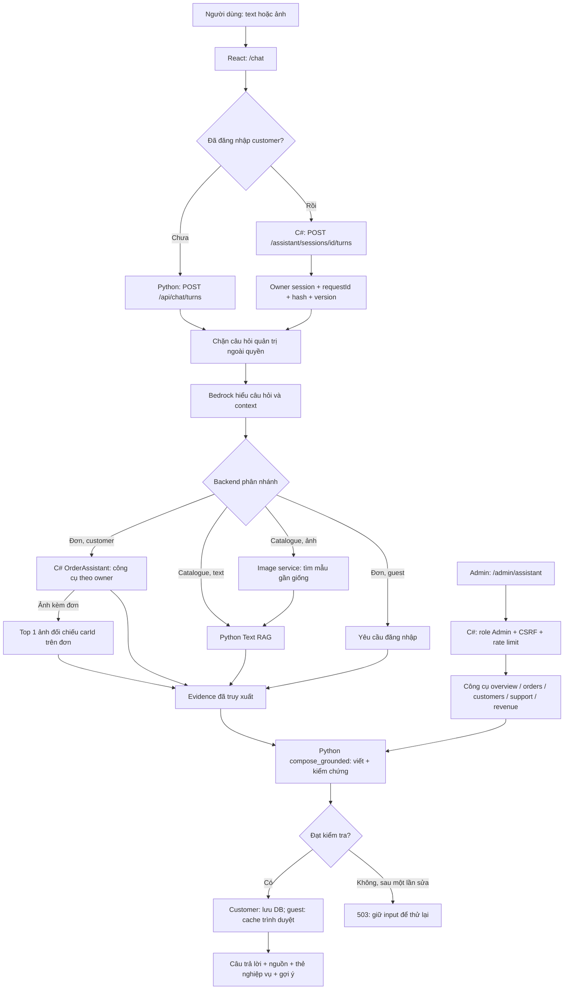

Sơ đồ gộp điểm viết/kiểm chứng dùng chung; khi trả lời catalogue, điểm này nằm bên trong `/api/chat`. Customer nhận kết quả rồi lưu vào C#; admin trả kết quả trực tiếp và chỉ giữ hội thoại trong bộ nhớ trang. Từ chối quyền quản trị được trả bằng authorization policy trước model, không đi qua Bedrock. Hỏi chưa rõ có thể trả lời làm rõ trước khi truy xuất.

## 2. Cổng vào, quyền và lịch sử

| Nhóm | API chính | Nguồn context | Lưu lịch sử |
|---|---|---|---|
| Guest | `POST /api/chat/turns` | Tối đa 3 câu hỏi gần nhất, câu trả lời gần nhất, ID/tên xe từ browser | `sessionStorage`, chưa có session RAG guest trong DB |
| Customer | `POST /api/orders-service/assistant/sessions/{id}/turns` | History server, xe vừa trao đổi, đơn hiện tại/trước đó, chủ đề, câu hỏi đang chờ làm rõ | PostgreSQL `orders_service`, payload/context/version; ảnh qua ChatAttachments |
| Admin | `POST /api/orders-service/admin/assistant/messages` | Câu hỏi và scope/bộ lọc của lượt hiện tại | Bộ nhớ trang, tối đa 30 lượt; không gửi lịch sử cho model |

`/api/orders-service` là prefix public của module C#. Guest chỉ cung cấp context hội thoại, không được cung cấp facts đáng tin về xe/đơn. Python truy xuất lại dữ liệu thực. Với customer, session và mọi đơn phải thuộc tài khoản hiện tại. Các endpoint nội bộ `/api/chat/understand`, `/compose`, `/title` yêu cầu internal token; public `/api/chat` không nhận evidence ảnh/clarification nội bộ nếu thiếu token.

Customer gửi `requestId` và `version`. Server so hash để replay cùng request mà không gọi model lại; cùng requestId nhưng payload khác hoặc version cũ gây conflict. Khi ghi, server khóa theo session và kiểm tra lại để tránh ghi trùng. Lỗi AI không tạo lượt thành công hoặc tăng version. Tên hội thoại là luồng phụ qua Bedrock, không phải công cụ truy xuất.

## 3. Text RAG: từ câu hỏi đến facts


Xem mã Mermaid

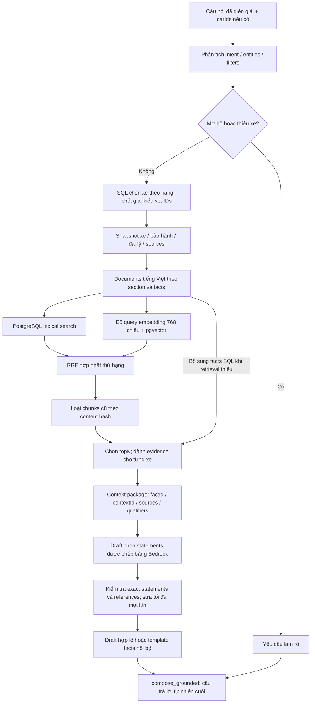

Intent chính: tìm xe, hỏi giá, thông số, bảo hành, tìm đại lý, so sánh. Backend hợp nhất filters và giới hạn carIds; không cho kết quả ảnh mở rộng sang mẫu khác. `topK` được giới hạn 1–20. Với so sánh phải đủ evidence cho các xe được yêu cầu.

Lexical/vector chỉ dùng documents còn khớp content hash với snapshot hiện tại. Vector yêu cầu index tương thích model/revision. RRF dùng `1 / (60 + rank)`. Nếu index thiếu/lỗi, hệ thống có thể dùng lexical hoặc facts có cấu trúc từ SQL. Đây là giảm cấp retrieval, không bỏ bước kiểm chứng câu trả lời cuối.

Có hai lớp sinh nội dung: draft RAG chọn dữ kiện được phép và câu trả lời tự nhiên cuối. Draft nội bộ có thể fallback template; response thành công trên pipeline chat hiện tại vẫn phải vượt qua `compose_grounded`. Không được diễn giải fallback draft là câu trả lời cuối không cần Bedrock.

Giới hạn nguồn được mang theo: giá VND có nguồn và là giá tham khảo; thông số DVM-CAR có phạm vi thị trường Anh; bảo hành phải giữ điều kiện; xe lịch sử không được nói như xe đang phân phối. Không tự suy đoán dữ liệu thiếu.

## 4. Ảnh: hai nhánh sử dụng


Xem mã Mermaid

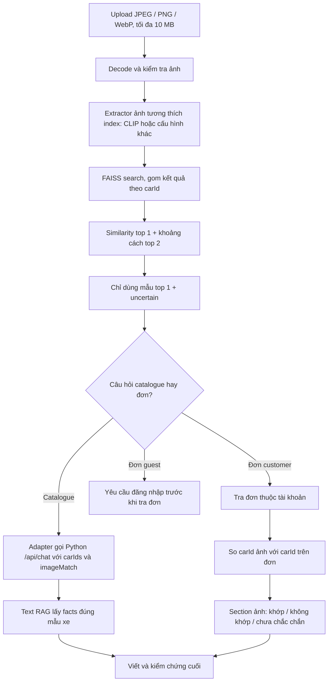

Catalogue ảnh đi qua image service `/chat`; service gọi `/search` nội bộ qua retriever rồi quay về common RAG. Đơn + ảnh đi qua C# UnifiedAssistant: gọi `/search/image`, sau đó đưa ImageOrderEvidence cho OrderAssistant. Confidence được tính từ tập ứng viên trước khi chỉ tiêu thụ top 1.

Similarity không phải xác suất nhận diện. Chỉ xác định mẫu gần giống trong catalogue; không xác minh chiếc xe thực tế, năm/phiên bản hay VIN. Nếu không có mẫu hoặc lỗi nhận diện, nhánh catalogue tạo câu trả lời làm rõ. Lỗi adapter/AI trả 503. Index ảnh riêng với PostgreSQL text index; đổi extractor/preprocessing phải dùng index tương thích.

## 5. Customer: context, multi-intent và công cụ


Xem mã Mermaid

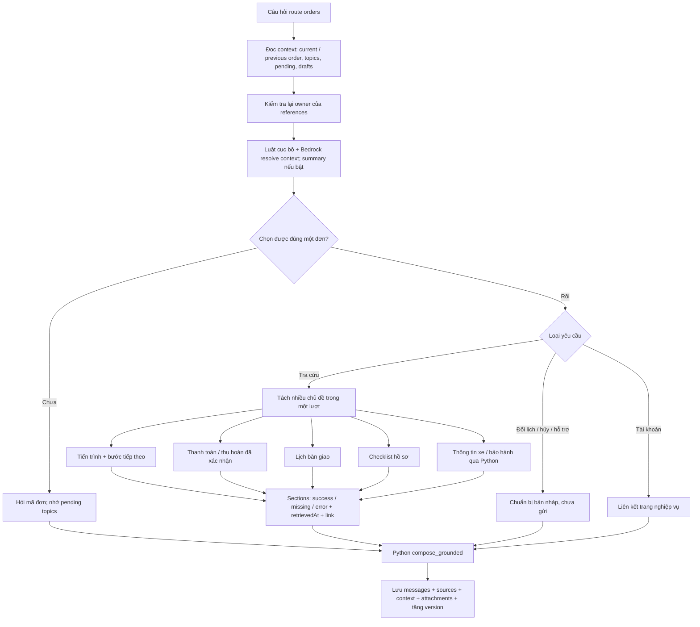

Topics rõ ràng trong câu hỏi ưu tiên hơn chủ đề suy ra từ lịch sử. Sau câu hỏi làm rõ, chỉ gửi mã đơn có thể tiếp tục các topics đang chờ. Nhiều mã đơn hoặc mã đơn không khớp đơn đang chọn phải làm rõ. Không có reference thì yêu cầu chọn đơn thay vì tự chọn. Các references do model đề xuất luôn chịu kiểm tra owner và ambiguity của backend.

Các công cụ chính: `ListMyOrders`, `GetMyOrderProgress`, `GetMyOrderPaymentSummary`, `GetMyDeliverySchedule`, `GetMyOrderDocuments`, `GetCarDetail`, `GetWarranty`, `GetMyOrderTopics`, `NavigateAccount`, `PrepareChangeDraft`, `PrepareSupportDraft`.

Thanh toán chỉ tính giao dịch đã xác nhận; tiền chốt trên đơn khác với giá tham khảo catalogue. Thông tin xe/bảo hành gọi API Python và ghi nhận thiếu/lỗi theo section. Một topic lỗi không được biến thành dữ liệu đã xác minh; kết quả nhiều section có thể `partial`. NextSteps là logic giao diện theo vai trò/kết quả, không phải vòng agent tự hành động.

## 6. Gửi yêu cầu thay đổi và chuyển hỗ trợ

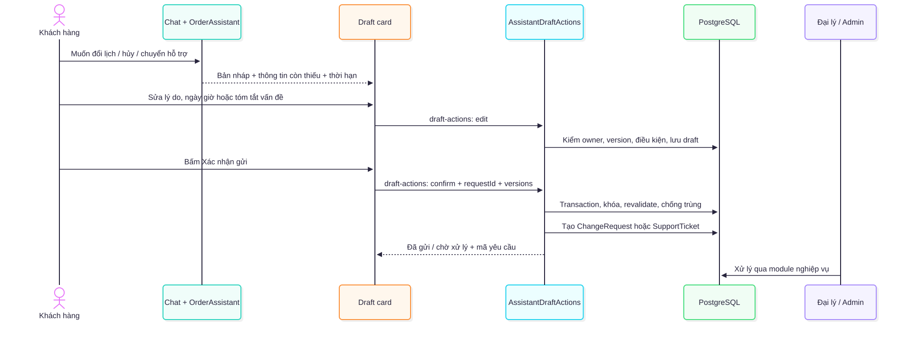

Xem mã Mermaid

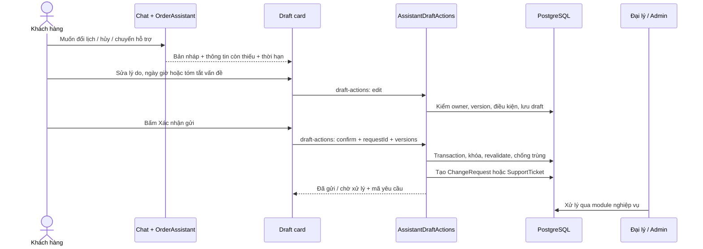

Draft hết hạn sau 30 phút và có thể edit/discard/confirm. Gõ “đồng ý”, “ok” hoặc “gửi đi” trong chat không gửi yêu cầu. Confirm đổi lịch/hủy tạo đề nghị cho admin xử lý; không lập tức đổi lịch hoặc trạng thái đơn. Phiếu support chứa liên kết đã kiểm tra và snapshot chủ đề/kết quả gần đây. Những thao tác này là API nghiệp vụ xác định, không phải model trực tiếp ghi DB.

## 7. Trợ lý Admin


Xem mã Mermaid

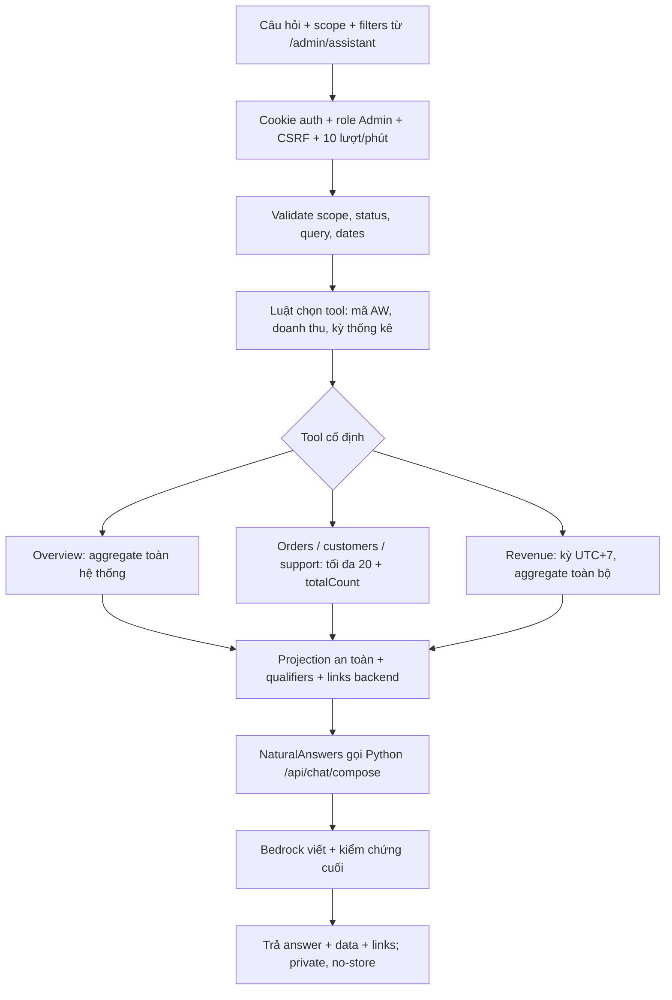

Admin assistant chỉ đọc dữ liệu. SQL/EF queries cố định và có tham số; model không tạo SQL, URLs hoặc thực hiện thay đổi. Bộ lọc và tool do UI/luật backend quyết định, khác routing ngôn ngữ của unified customer chat.

Revenue vận hành là tổng giá chốt các đơn hoàn thành theo ngày bàn giao thực tế; dòng tiền là thu/hoàn đã xác nhận theo ngày xác nhận, tính thu ròng. Chưa là doanh thu kế toán, không có chi phí/lợi nhuận. Kỳ theo UTC+7; ngày chọn rõ ràng ưu tiên hơn câu hỏi. Danh sách bị cắt 20 không ảnh hưởng aggregate toàn bộ dữ liệu. Không gửi mật khẩu/security stamp/audit cho AI, không đọc phản hồi và ghi chú nội bộ support.

Guest/customer hỏi thống kê quản trị bị từ chối trước model, `status=forbidden`, `generationMode=authorization-policy`, không evidence/citations. Quyền thật vẫn được bảo vệ bằng endpoint Admin riêng và owner trong mọi truy vấn customer.

## 8. Bước trả lời cuối dùng chung

Xem mã Mermaid

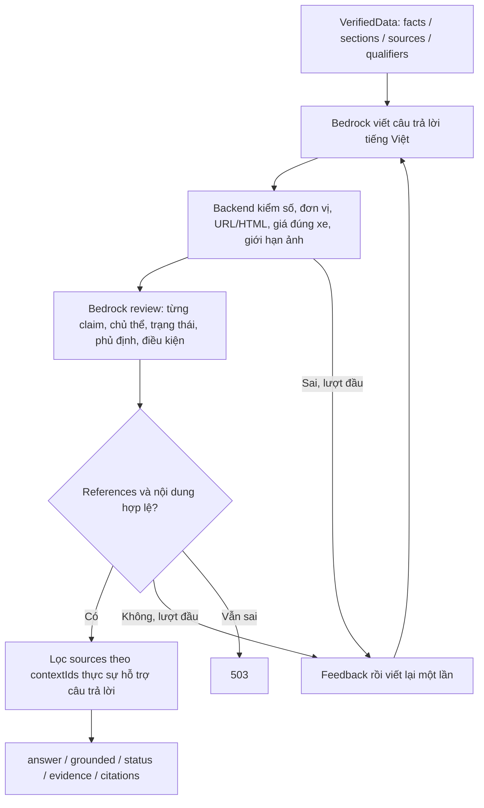

Registry nguồn đến từ retrieval/công cụ; model không được tạo sourceId/URL mới. Metadata cuối được tính từ câu trả lời đã review, không sao chép nhãn grounded của draft. Các status thường gặp: `ok`, `partial`, `no_data`, `needs_clarification`; `forbidden` là policy riêng. Grounding bằng LLM là lớp kiểm tra bổ sung, không đảm bảo tuyệt đối mọi cách diễn đạt. Chi phí/latency gồm hiểu câu hỏi, các bước RAG/context tùy nhánh, viết và review, có thể thêm repair/title/summary.

## 9. Chuẩn bị dữ liệu và thông báo nền

Xem mã Mermaid

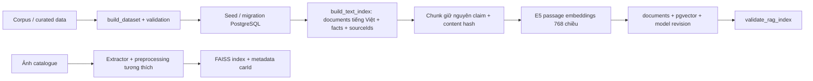

Index text chỉ cập nhật documents thay đổi và embeddings thiếu/khác revision; xóa orphan, tránh ghi embedding nếu document đổi trong lúc inference. Query E5 và passage E5 dùng prefix riêng. Dữ liệu ảnh/index riêng phải đồng bộ carId với catalogue.

Xem mã Mermaid

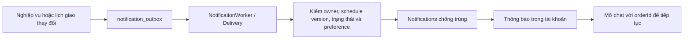

Thông báo là worker nghiệp vụ, không cần LLM. Nhắc giao dùng mốc 08:00 giờ Việt Nam của ngày giao, lùi một ngày; lịch cũ/hủy/đã bàn giao không được phát nhắc cũ. Outbox xử lý retry và chống trùng.

## 10. Mã nguồn đối chiếu

| Phần | File chính |
|---|---|
| Giao diện và guest | `frontend/src/pages/ChatPage/index.tsx`, `frontend/src/features/chat/storage.ts` |
| Customer, draft cards | `frontend/src/features/orders/OrderAssistantPage.tsx`, `AssistantDraftCard.tsx`, `SupportDraftCard.tsx` |
| Routing và API C# | `services/owner-features/src/AutoWise.OwnerFeatures.Api/Program.cs`, `Infrastructure/UnifiedAssistant.cs` |
| Guest routing | `backend/app/routers/guest_chat.py`, `infrastructure/ai/question_understanding.py` |
| RAG | `backend/app/application/rag/{rag,text_retriever,intent,context_builder,documents,indexing}.py`, `repositories/rag_repository.py` |
| Final answer | `backend/app/routers/chat.py`, `infrastructure/ai/{natural_answers,answer_grounding,bedrock}.py` |
| Ảnh | `image_service/app/routers/chat.py`, `core/{image_retriever,feature_extractor,vector_index,rag_adapter}.py` |
| Đơn/context | `services/owner-features/src/AutoWise.OwnerFeatures.Infrastructure/{OrderAssistant,BedrockAssistant}.cs`, `Application/ConversationContext*.cs` |
| Draft và support | `Infrastructure/{AssistantDraftActions,SupportStore}.cs` dưới module owner-features |
| Admin | `Infrastructure/{AdminAssistant,AdminFinance,NaturalAnswers}.cs` dưới module owner-features |
| Thông báo | `Infrastructure/NotificationDelivery.cs`, `Api/NotificationWorker.cs` dưới module owner-features |

README và tài liệu trạng thái đã được đối chiếu lại ngày 11/10/2026: unified chat/image/admin dùng các luồng trên. Sơ đồ không đưa voice, web search, model tự chạy SQL hay agent loop vào vì chưa thấy các luồng đó trong implementation được đối chiếu.
